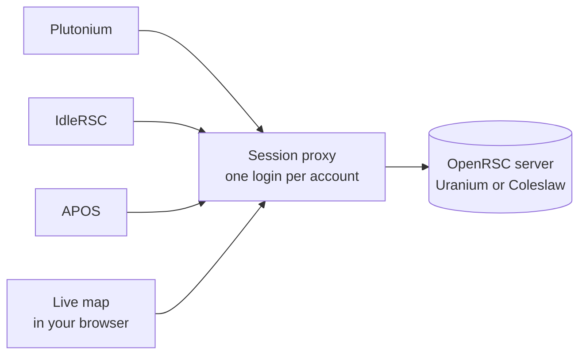
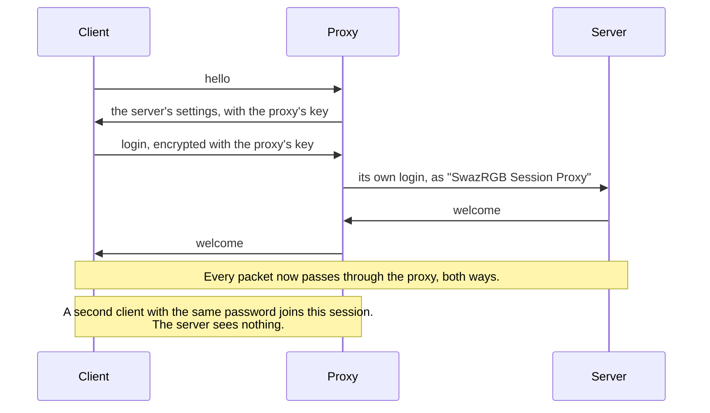

# rsc-map-renderer

RuneScape Classic tools for the [OpenRSC](https://gitlab.com/openrsc/openrsc) worlds: 2D and 3D world maps, a
pathfinder that knows every ladder, gate and boat, a headless game client, and a **session proxy** that keeps your
accounts logged in while your clients come and go.

**[3D world map](https://swazrgb.github.io/rsc-map-renderer/)**  
[](https://swazrgb.github.io/rsc-map-renderer/)

**[2D world map](https://swazrgb.github.io/rsc-map-renderer/2d/)**  
[](https://swazrgb.github.io/rsc-map-renderer/2d/floor-0.light.preview.png)

## The session proxy

Your client connects to the proxy instead of the game server. The proxy logs in for it, and keeps that login.



- **One login, many clients.** Several clients can play one account at once. The server sees one login.
- **Survives disconnects.** Close a client and the account stays logged in, 30 seconds by default. Reconnect and you
  are back where you were.
- **A live map.** A web page with every account on the 2D and 3D map, its inventory, bank, skills and quests. Plan a
  route and walk it, or open a browser client on the account.
- **`::pause`** in one client holds off the others' input, until you type it again.

It runs on Uranium and Coleslaw only, the two OpenRSC worlds that allow bots.

### How a login goes



The proxy writes every login itself. It keeps the client's version and the limits it declares, encrypts the password
with the server's key, and names itself `SwazRGB Session Proxy` in the login details the server logs. So the proxy reads
your password, as your client does.

The last client's logout goes to the server, which decides it as usual: never in combat.

### Run it

1. Install Java 26 or newer, such as [Temurin](https://adoptium.net/).
2. Download `session-proxy.zip` from the [latest release](https://github.com/swazrgb/rsc-map-renderer/releases/latest)
   and unzip it.
3. Run `java -jar session-proxy.jar`, or double-click `session-proxy.cmd` on Windows.
4. The first run writes `session-proxy.yaml` and stops. Set `world: uranium` or `world: coleslaw`, and start it again.

| Setting | Default | |
| --- | --- | --- |
| `world` | | `uranium` or `coleslaw` |
| `listen` | `127.0.0.1:43600` | Where clients connect. |
| `web` | `127.0.0.1:43602` | The live map, or `off`. |
| `status` | `127.0.0.1:43601` | `GET /sessions` lists the sessions as JSON, or `off`. |
| `hold` | `30` | Seconds a session stays logged in after its last client leaves. `0`: until the server ends it. |
| `hosts` | | Names the live map also answers to, behind a reverse proxy. |
| `data` | `data` | The baked 3D world and the proxy's key. |

A flag of the same name overrides a setting: `--web off`.

> **The live map has no login.** Anyone who can open it sees and plays every account. Keep `web` on `127.0.0.1`
> unless you trust your network.

### Connect your client

Point the client at the proxy, `127.0.0.1:43600` by default, instead of the game server.

**Plutonium** (Uranium only), in `settings.toml`:

```toml
[server]
address = "127.0.0.1:43600"
```

Then run `plutonium -d` once, so it saves the proxy's key. A key file fetched from the server itself is refused.

**IdleRSC**: in the account's settings pick **Custom** for both the server address and the port, or set this in
`accounts/<account>.properties`:

```properties
account-server-option-address=Custom
account-server-custom-address=127.0.0.1
account-server-option-port=Custom
account-server-custom-port=43600
```

**APOS** speaks RuneScape's own 2004 protocol (version 235), which the proxy translates, on either world. APOS has the
server's key built in, so it needs the proxy's key instead, and a rebuild. Each proxy makes its own key on its first
run, keeps it in `data/authentic-client-key.pem`, and logs it on every start:

```
Clients log in with the proxy's key, in …/data/authentic-client-key.pem; APOS needs it built in: modulus 9267…177, exponent 65537
```

Put it into APOS's source, under `client/src/main/java/com/aposbot/`:

```java
// Constants.java: the modulus and exponent your proxy logged
public static final String RSAKEY_URANIUM_MEMB = "<modulus>";
public static final String RSAEXPONENT_URANIUM_MEMB = "65537";

// gui/BotFrame.java, in both places: the proxy's host, and its port minus 40000 as the nodeid
new URL("http://127.0.0.1/")   // was http://game.openrsc.com/
"3600"                         // was "3601"
```

Then build it with `compile_all.cmd`, or `compile_all_linux.sh`. Keep the key file: a new key means building APOS
again.

A session keeps the limits of the client that opened it. When APOS and an OpenRSC client share an account, log in with
the OpenRSC client first: in a session APOS opened, an item APOS cannot show drops to the ground.

## What's in here

| Module | |
| --- | --- |
| `game-data/` | The OpenRSC data tree loaded as one world: definitions, spawns, landscape, collision. |
| `nav/` | The pathfinder: every transport as data, the routing engine, and the route follower. |
| `game-client/` | A headless OpenRSC client: login, packets, and the game state they build. |
| `session-proxy-core/` | The session proxy, and the live map it serves. |
| `bot-api/`, `account-data/` | What a client sends in a tick, and an account's state, as plain data. |
| `map2d/`, `world3d-bake/` | Bake the 2D map layers and the 3D world assets. |
| `viewer/` | The WebGL 3D world viewer. [Embedding it](viewer/README.md). |
| `live-map/`, `live-map-web/` | The live map's endpoints and web page. |
| `client-render/` | A headless port of the client's software renderer. |
| `nav-web/`, `teavm-classlib-patch/` | The pathfinder compiled to WebAssembly, for the viewer demo. |
| `orsc-teavm-client/` | The browser game client, a submodule from [its own repo](https://github.com/swazrgb/orsc-teavm-client). |

## Build

Needs JDK 26 and an [OpenRSC](https://gitlab.com/openrsc/openrsc) checkout beside this repo (`../openrsc`).

```bash
scripts/release-session-proxy.sh target/session-proxy.zip   # the session proxy, as released
scripts/build-site.sh site                                    # the 3D viewer demo
scripts/render-map.sh map-out                                 # the 2D map layers
```

Other worlds, landscapes and the dev loop: [BUILDING.md](BUILDING.md).

## License

[AGPL-3.0](LICENSE), as OpenRSC's own. The session proxy's release carries OpenRSC's game data and a build of its
client, under the same license.
